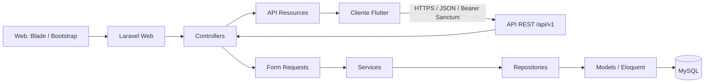

# HostalConnect UNAB

Sistema de gestión de hostal con aplicación web Laravel, API REST versionada y cliente Flutter. Esta entrega consolida los módulos existentes para validación y demostración; no incorpora funcionalidades nuevas.

## Tecnologías

| Componente | Tecnología |
| --- | --- |
| Backend y web | PHP 8.4, Laravel 12, Blade |
| Base de datos | MySQL 8.4 |
| API | REST `/api/v1`, Laravel Sanctum, API Resources |
| Interfaz web | Blade, Bootstrap 5 |
| Cliente móvil | Flutter, Dart, Provider, GoRouter |
| Entorno local | Docker Compose, PHP-FPM, Nginx |

## Requisitos

- Docker Engine y Docker Compose v2 para ejecutar el backend.
- Flutter Stable 3.44.0+ y Dart 3.12.0+ para desarrollar/ejecutar `mobile/`.
- Git para clonar el repositorio.

## Inicio local con Docker

Desde la raíz del repositorio:

```bash
cp .env.example .env
```

Configura en `.env` contraseñas locales para `DB_PASSWORD` y `DB_ROOT_PASSWORD`. Los valores de ejemplo son solo para desarrollo. Luego inicia los servicios, genera la clave de Laravel y aplica las migraciones:

```bash
docker compose up --build -d
docker compose exec app php artisan key:generate
docker compose exec app php artisan migrate
```

La aplicación web/API queda disponible en `http://localhost:8080` (el puerto se puede cambiar con `APP_HTTP_PORT`). `/up` es el endpoint de salud de Laravel. MySQL solo está expuesto dentro de la red de Compose y sus datos persisten en el volumen `mysql_data`.

Para poblar una base local vacía con datos de demostración generados por factories:

```bash
docker compose exec app php artisan db:seed
```

El seeder genera datos ficticios; no lo ejecutes sobre una base compartida o de producción. Las cuentas válidas para probar deben configurarse localmente y no se distribuyen credenciales compartidas en este README. Al detener la aplicación, `docker compose down` conserva los datos; `docker compose down --volumes` también elimina los volúmenes y sus datos.

## Despliegue en Render

El Blueprint [render.yaml](./render.yaml) prepara dos servicios en la región Ohio: Laravel web y MySQL 8.4 privado. La web se sirve por Nginx/PHP-FPM en el puerto que Render entrega en `PORT`; las migraciones se ejecutan antes de cada despliegue. El Dockerfile de Render es independiente del Dockerfile y Compose de desarrollo local.

1. Sube el repositorio a GitHub y en Render selecciona **New → Blueprint**, el repositorio y la rama que contiene `render.yaml`.
2. Render solicitará `APP_KEY` y `APP_URL` porque no se guardan en el repositorio. Genera la clave desde la raíz con `docker compose exec app php artisan key:generate --show`. Configura `APP_URL` con la URL HTTPS pública que Render asigne al servicio web.
3. Revisa los planes y crea los servicios. El Blueprint usa el plan pagado `1c-2g` para cada servicio y un disco MySQL persistente de 10 GB. Render genera las contraseñas de MySQL y las comparte de forma privada con Laravel; no las copies a Git ni a `APP_KEY`.
4. Espera el despliegue y comprueba `https://<dominio-render>/up`, el login web y `https://<dominio-render>/api/v1`. La app Flutter debe usar ese mismo origen como `API_BASE_URL`; sus rutas API agregan `/api/v1`.

Variables que requieren un valor manual:

| Variable | Valor |
| --- | --- |
| `APP_KEY` | Clave estable de Laravel, generada con `php artisan key:generate --show`. Guárdala solo en los secretos de Render y no la regeneres en cada despliegue. |
| `APP_URL` | URL HTTPS exacta asignada al servicio web, sin ruta adicional. |

El Blueprint configura `APP_ENV=production`, `APP_DEBUG=false`, `DB_CONNECTION=mysql`, `DB_HOST`, `DB_PORT`, `DB_DATABASE`, `DB_USERNAME`, `DB_PASSWORD`, `LOG_CHANNEL=stderr`, sesiones cifradas en cookie y las opciones de cola/cache actuales. El servicio MySQL genera `MYSQL_PASSWORD` y `MYSQL_ROOT_PASSWORD`; Render proporciona `PORT` automáticamente. No configures `APP_HTTP_PORT` en Render: esa variable solo cambia el puerto local de Compose.

El almacenamiento local de archivos, la cache en archivo y la cola `sync` no son compartidos entre instancias; el Blueprint está pensado para una sola instancia de la app y no agrega workers ni scheduler, que el código actual no requiere. El correo usa el canal `log` y no envía mensajes reales. Configura backups de MySQL con `mysqldump` y almacénalos fuera de Render; no dependas de snapshots del disco como método de restauración. Revisa los costos/planes vigentes de Render antes de crear recursos y prueba la restauración antes de usar datos reales.

## Despliegue en Azure VM

El despliegue de demostración utiliza una VM Ubuntu 24.04 `Standard_D2s_v3` en Central US, Laravel/PHP-FPM + Nginx, MySQL 8.4 privado y Caddy para HTTPS. El template Bicep abre solo los puertos 80/443 y restringe SSH a la IPv4 del equipo que despliega. La base productiva inicia vacía y se crean exactamente tres cuentas de demostración mediante `DemoAccountsSeeder`; **no ejecutes el seeder general** en producción.

Requisitos: Azure CLI autenticada en la suscripción autorizada, Docker Engine, OpenSSL, Python 3, SSH y una clave SSH existente. Desde la raíz:

```bash
bash scripts/deploy-azure-vm.sh
```

El script solicita la contraseña compartida sin mostrarla en pantalla, compila localmente la imagen, crea los recursos declarados en [infra/azure-vm/](./infra/azure-vm/), genera claves de Laravel/MySQL, aplica migraciones, crea las tres cuentas y prueba `https://<FQDN>/up`. No copies el archivo de entorno del servidor ni la contraseña al repositorio. La IP pública es estática; la etiqueta DNS gratuita la genera Azure. Para detalles operativos, costos y comandos SSH consulta [la guía de Azure VM](./infra/azure-vm/README.md).

Para poblar reservas, menú, productos, mesas, pedidos, incidencias y pagos de demostración en una base que ya tiene las tres cuentas, ejecuta `php artisan db:seed --class=DemoDataSeeder --force` en el contenedor `app`. Este seeder reutiliza el cliente y operador existentes, no agrega usuarios, se puede repetir sin duplicar sus registros y crea pagos pendientes de demostración (no procesa cobros). No uses el seeder general en la base Azure: también crea usuarios adicionales.

La estimación consultada es ~USD 88.43/mes si la VM permanece encendida durante 730 horas, más tráfico e impuestos. Desasignar la VM detiene el cómputo, pero también deja la app y la API fuera de línea.

Despliegue demo activo: [HostalConnect UNAB](https://hostalconnect-modzr3g6xybig.centralus.cloudapp.azure.com), con salud HTTPS verificada en [`/up`](https://hostalconnect-modzr3g6xybig.centralus.cloudapp.azure.com/up). Se probaron en vivo login, restauración de sesión y revocación del token para las tres cuentas de demostración. El APK debug local apunta a este origen y está instalado en el Android conectado; no es una versión firmada para tiendas. **Advertencia:** Chrome en el dispositivo mostró una intersticial de Google Safe Browsing para este FQDN. No la omitas; revisa la reputación del dominio o usa un dominio propio verificado antes de distribuir públicamente.

## Arquitectura



En las operaciones de aplicación se mantiene la separación Controller → Request → Service → Repository → Model; las respuestas API se serializan con Resources. Las vistas Blade presentan la información y no deben contener lógica de negocio. La autorización se realiza mediante middleware de roles y Policies/Gates; el backend conserva la autoridad sobre ownership, validaciones y transiciones.

## Módulos

- Autenticación y dashboard con acceso por rol (`ADMINISTRADOR`, `OPERADOR`, `CLIENTE`).
- Reservas y consulta de disponibilidad de mesas.
- Pedidos, detalle y transiciones de estado.
- Catálogo de productos y menú del día.
- Registro/consulta de pagos e incidencias.
- Cliente móvil: autenticación, catálogo, pedidos, pagos, reservas, incidencias y gestión de menú para personal.

## API REST

La API está bajo `/api/v1`. `POST /api/v1/login` permite iniciar sesión; las demás rutas requieren `Authorization: Bearer <token>` emitido por Sanctum. `POST /api/v1/logout` revoca el token actual y `GET /api/v1/me` devuelve la identidad autenticada. Las respuestas JSON usan `data`, `message` y `meta`; las colecciones añaden `links`.

| Recurso | Operaciones principales |
| --- | --- |
| Incidencias | listar, reportar, actualizar |
| Reservas | listar, disponibilidad, crear, consultar, actualizar, cancelar |
| Pedidos y pagos | listar/crear/consultar/actualizar/cancelar pedidos; cambiar estado; listar/crear/consultar pagos |
| Productos | listar y consultar |
| Menús del día | listar, consultar menú actual, crear/actualizar borrador, publicar |

La colección Postman [HostalConnect-UNAB-API-v1.postman_collection.json](./docs/postman/HostalConnect-UNAB-API-v1.postman_collection.json) contiene 29 solicitudes para las rutas actuales. Importa también el entorno [HostalConnect-UNAB-Local.postman_environment.json](./docs/postman/HostalConnect-UNAB-Local.postman_environment.json), usa `http://localhost:8080` como `baseUrl`, completa localmente las credenciales de una cuenta válida y ejecuta primero **Iniciar sesión**. Los IDs de ejemplo dependen de los datos presentes en la base. No guardes tokens ni contraseñas en archivos versionados.

Las operaciones de registro de pago requieren `Idempotency-Key`; el backend registra la solicitud como pendiente y no procesa tarjetas ni confirma un cobro real. Los errores incluyen códigos como 401, 403, 404, 405, 409, 422 y 429.

## Cliente Flutter

El proyecto móvil vive en [`mobile/`](./mobile/). Sigue su [guía de instalación, configuración por ambiente y pruebas](./mobile/README.md). En resumen:

```bash
cd mobile
flutter pub get
flutter analyze
flutter test
```

Para Android Emulator contra el backend local:

```bash
flutter run --dart-define=APP_ENV=development --dart-define=API_BASE_URL=http://10.0.2.2:8080
```

Para iOS Simulator usa `http://localhost:8080`; para un dispositivo físico, la dirección LAN del host. Staging y producción requieren una URL HTTPS explícita. No pases secretos mediante `--dart-define`.

## Pruebas y estado de validación

Backend, desde el servicio `app`:

```bash
docker compose exec app php artisan test
docker compose exec app vendor/bin/pint --test
```

Para validar la configuración y las rutas:

```bash
docker compose exec app php artisan route:list
docker compose exec app php artisan route:list --path=api/v1
git diff --check
```

La suite Laravel usa SQLite en memoria. El informe de integración registra una ejecución HTTP contra Laravel/MySQL y aclara que no se ejecutó el binario Flutter contra una API/MySQL viva. Las pruebas Flutter registradas por CI fueron 72 aprobadas y 1 omitida por requerir configuración de staging; consulta los informes para el alcance exacto y los límites de esa evidencia:

- [Auditoría arquitectónica](./docs/architecture-audit-v1.0.md)
- [Auditoría de seguridad](./docs/security-audit-v1.0.md)
- [Checklist de pruebas funcionales](./docs/functional-test-checklist-v1.0.md)
- [Informe de integración](./docs/integration-test-report-v1.0.md)
- [Revisión de rendimiento](./docs/performance-review-v1.0.md)
- [Contrato y validación de API](./docs/api-v0.3-validation.md)

El despliegue demo en Azure y la API con MySQL fueron comprobados, pero no equivalen a certificar producción crítica. Siguen pendientes pruebas de carga/estrés, restauración de backups y firma/publicación en tiendas. El teléfono alcanzó el puerto TCP 443 de la VM, pero la ROM Xiaomi denegó la inyección de eventos ADB necesaria para automatizar el formulario Flutter; por ello, el inicio de sesión móvil debe comprobarse manualmente. El Compose de desarrollo local no es una arquitectura de producción.

Consulta el [checklist de despliegue v1.0](./docs/deployment-checklist-v1.0.md) para hallazgos, criterios de salida y verificaciones pendientes antes de producción.

Para organizar la demostración y revisar la evidencia conocida, usa el [checklist de sustentación v1.0](./docs/defense-checklist-v1.0.md).

Consulta el [informe final v1.0](./docs/final-v1.0-report.md) para el estado consolidado, lecciones aprendidas y deuda técnica pendiente.
